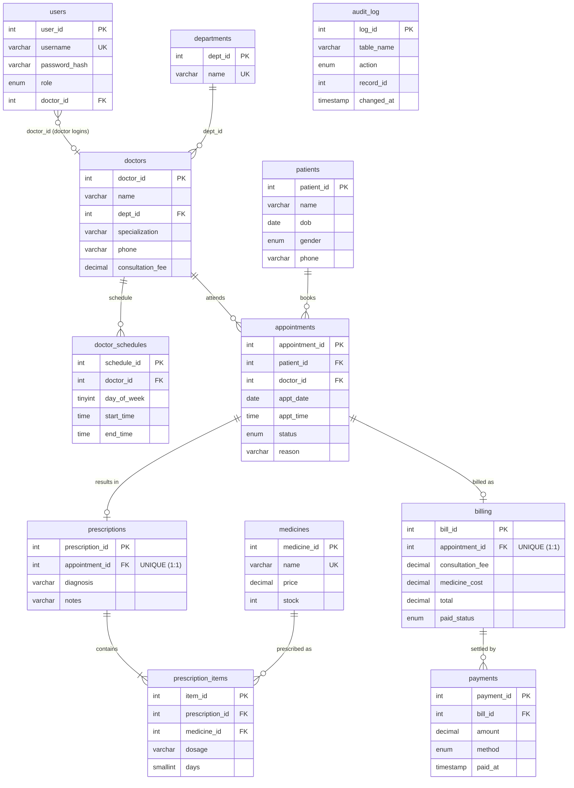

# ER Diagram & Relational Schema

## Mermaid ER diagram (renders on GitHub)



## dbdiagram.io source (paste at dbdiagram.io)

```dm
Table departments {
  dept_id int [pk, increment]
  name varchar(100) [unique, not null]
}
Table doctors {
  doctor_id int [pk, increment]
  name varchar(150) [not null]
  dept_id int [ref: > departments.dept_id]
  specialization varchar(100)
  phone varchar(20)
  consultation_fee decimal(10,2) [note: 'CHECK > 0']
}
Table patients {
  patient_id int [pk, increment]
  name varchar(150)
  dob date [note: 'CHECK <= today']
  gender enum 'male,female,other'
  phone varchar(20)
  email varchar(150)
  address varchar(255)
}
Table doctor_schedules {
  schedule_id int [pk, increment]
  doctor_id int [ref: > doctors.doctor_id]
  day_of_week tinyint [note: '1=Mon … 7=Sun']
  start_time time
  end_time time [note: 'CHECK start < end']
}
Table appointments {
  appointment_id int [pk, increment]
  patient_id int [ref: > patients.patient_id, note: 'DELETE RESTRICT']
  doctor_id int [ref: > doctors.doctor_id, note: 'DELETE RESTRICT']
  appt_date date
  appt_time time
  status enum 'booked,completed,cancelled' [default: 'booked']
  reason varchar(255)
  indexes {
    (doctor_id, appt_date, appt_time) [unique: 'no double booking']
    (doctor_id, appt_date)
  }
}
Table prescriptions {
  prescription_id int [pk]
  appointment_id int [unique, ref: > appointments.appointment_id]
  diagnosis varchar(255)
  notes varchar(500)
}
Table prescription_items {
  item_id int [pk]
  prescription_id int [ref: > prescriptions.prescription_id]
  medicine_id int [ref: > medicines.medicine_id]
  dosage varchar(100)
  days smallint
}
Table medicines {
  medicine_id int [pk]
  name varchar(150) [unique]
  price decimal(10,2)
  stock int [note: 'CHECK >= 0']
}
Table billing {
  bill_id int [pk]
  appointment_id int [unique, ref: > appointments.appointment_id]
  consultation_fee decimal(10,2)
  medicine_cost decimal(10,2)
  total decimal(10,2)
  paid_status enum 'unpaid,paid'
}
Table payments {
  payment_id int [pk]
  bill_id int [ref: > billing.bill_id]
  amount decimal(10,2)
  method enum 'cash,card,upi,insurance'
  paid_at timestamp
}
Table users {
  user_id int [pk]
  username varchar(50) [unique]
  password_hash varchar(255)
  role enum 'admin,doctor,receptionist'
  doctor_id int [ref: - doctors.doctor_id]
}
Table audit_log {
  log_id int [pk]
  table_name varchar(64)
  action enum 'UPDATE,DELETE,INSERT'
  record_id int
  changed_at timestamp
}
```

## Cardinality summary

| Relationship | Cardinality | Enforced by |
|---|---|---|
| departments → doctors | 1 : N | `doctors.dept_id` FK |
| doctors → doctor_schedules | 1 : N | FK + CASCADE delete |
| patients → appointments | 1 : N | FK, `ON DELETE RESTRICT` |
| doctors → appointments | 1 : N | FK, `ON DELETE RESTRICT` + `UNIQUE(doctor, date, time)` |
| appointments → prescriptions | 1 : 1 | `prescriptions.appointment_id` UNIQUE FK |
| appointments → billing | 1 : 1 | `billing.appointment_id` UNIQUE FK |
| prescriptions ↔ medicines | M : N | bridge `prescription_items` |
| billing → payments | 1 : N | FK, `ON DELETE RESTRICT` |
| users → doctors | optional 0..1 | nullable FK `ON DELETE SET NULL` |
